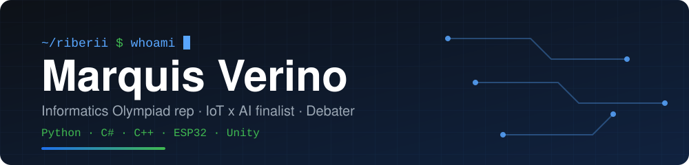

  

---

## 👋 About me

I'm a student from Surabaya who likes building things where **software meets hardware**: from an ESP32 plant-watering system with AI leaf diagnosis to physics-driven Unity games. I represent my school in the **Informatics Olympiad (OSN)**, compete in national debate circuits, and have spent 5 years in coding clubs going from Scratch → Python → C++.

Right now I'm building out my CS university portfolio, and my long-term goal is **cybersecurity**.

## 🏆 Highlights

| | Details |
|---|---|
| 🥇 **Hackathon** | **Finalist, UKP Hackathon IoT x AI**. Built **AgriSense**, an auto-watering plant system (ESP32) combined with image recognition (Teachable Machine) that checks leaf condition |
| 🛰️ **NASA** | Currently participating in the **NASA Space Apps Challenge** |
| 🧠 **Informatics** | **School representative** for OSN (National Science Olympiad), Informatics |
| 🗣️ **Debate & speech** | HICOM, Wirasena Kemenpora debate & speech competition · attended a **Harvard Debate Council** workshop at Ciputra School Surabaya · 2nd place, English news speaking (school) |
| 🧩 **Competitions** | Bebras · ICAS · Schematics NPC Junior (C++) |

## 🌱 Featured: AgriSense

An IoT x AI system that closes the loop between a plant and its care:

- **IoT layer:** ESP32-based automatic watering system, built on my own electronics knowledge (current, voltage, resistance) rather than copy-paste wiring.
- **AI layer:** a Teachable Machine image-recognition model that looks at a leaf and classifies its condition.
- **Result:** Finalist at the UKP Hackathon IoT x AI.

<!-- TODO: once the AgriSense repo is public, add: [View the repository](https://github.com/riberii/AgriSense) -->

## 🛠️ Selected projects

| Project | What it is | Stack |
|---|---|---|
| [Surabaya-Care-Portal](https://github.com/riberii/Surabaya-Care-Portal) | Full-stack web prototype for community support and mental health awareness, deployed on PythonAnywhere | Python · Flask · HTML |
| [A-Star-Pathfinding-Tool](https://github.com/riberii/A-Star-Pathfinding-Tool) | Visualization of the A* algorithm with Manhattan heuristics for 2D navigation | Python |
| [TBS-Combat-Simulator](https://github.com/riberii/TBS-Combat-Simulator) | Turn-based combat system exploring state-based gameplay and enemy AI scaling | Python |
| [Spherical-Physics-Lab](https://github.com/riberii/Spherical-Physics-Lab) | 3D exploration of torque, linear force and momentum in the Unity physics engine | Unity · C# |
| [Crushed-Survival-2D](https://github.com/riberii/Crushed-Survival-2D) | High-tension vertical platformer with procedural hazards and precise collision detection | Unity · C# |
| [Blade-Fruit-3D](https://github.com/riberii/Blade-Fruit-3D) | 3D slicing mechanic built on collision triggers and velocity tracking | Unity · C# |
| [Edge-Impulse-Leaf-Pest-Detection-Model](https://github.com/riberii/Edge-Impulse-Leaf-Pest-Detection-Model) | Real-time leaf pest and disease classification model for web and edge platforms | Edge Impulse · WebAssembly |

## 💻 Skills

&nbsp;&nbsp;
&nbsp;&nbsp;
&nbsp;&nbsp;
&nbsp;&nbsp;
&nbsp;&nbsp;
&nbsp;&nbsp;
&nbsp;&nbsp;

 

- **Programming:** Python (main language) · C# (Unity 2D & 3D) · Java (Minecraft modding) · C++ (learning, algorithms & competitive programming)
- **Web:** Flask, HTML/CSS. Web developer at **SustainOBite**, a non-profit school organisation
- **Hardware & IoT:** ESP32 · Arduino · line-follower robotics (4 years) · how current, voltage and resistance actually behave in a circuit
- **AI & automation:** Teachable Machine · prompt engineering · scripting, macros and bots · AI safety & regulation (independent analysis)
- **Systems:** networking fundamentals · Minecraft SMP server hosting and management
- **Math & physics:** Basic & Advanced Math, Physics, applied directly in Unity physics and hardware projects

## 📚 Experience & activities

- **Web Developer**, SustainOBite (non-profit school organisation)
- **Coding club**, 5 years (Scratch → Python → C++)
- **Robotics club**, 4 years (line-follower robots)
- **Science club**, 3 years
- **Unity game development**, 2 years
- **Math club**, 2 years · **Financial literacy club**, 2 years
- **Debate club**, regular competitor in national debate and speech competitions
- **Seminars:** cybersecurity, AI, computer science, food chemistry, virology and more

## 🔭 Currently

- 🛰️ Taking part in the **NASA Space Apps Challenge**
- ⚙️ Learning **C++** for algorithms and competitive programming
- 🎮 Going deeper into **advanced C# for Unity**: physics-based mechanics and collision optimization
- 🌐 Expanding my **backend Flask** skills
- 🔐 Next on the list: **cybersecurity**

## 🌏 Languages

| Language | Level |
|---|---|
| 🇮🇩 Indonesian | Native |
| 🇬🇧 English | Very good |
| 🗣️ Javanese | Good |
| 🇲🇾 Malay | Basic (frequent visits to Malaysia, friends there) |
| 🇯🇵 Japanese | Learning (beginner) |
| 🇨🇳 Mandarin | Learning (HSK 1) |

## 🤝 Let's collaborate

I'm looking to team up on **open-source Unity 3D games** and **Python-based AI utility scripts**, and I'd love guidance on **backend Flask** and **AI development**.

## ⚡ Fun facts

- INTP, and I treat Surabaya's public transport like a shortest-path puzzle.
- Daily ritual: logic puzzles like Pydle and Wordle.
- I once spent a whole weekend debugging a single Flask deployment, and seeing it go live was worth it.

---

### Let's build something

[**📫 Email me**](mailto:marquisverino12@gmail.com) &nbsp;•&nbsp; [**🐙 GitHub**](https://github.com/riberii)

Always happy to talk Unity, IoT, AI, debate or cybersecurity.

